<div align="center">
  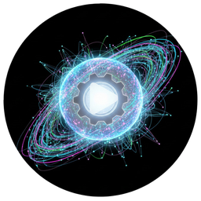
  <h1>Universal SR Studio</h1>
  <p>Graphical interface for training super-resolution AI models<br>with <strong>NeoSR</strong> and <strong>traiNNer-Redux</strong> engines.</p>

  <a href="https://github.com/Crysisjim/Universal-SR-Studio/releases"></a>
  <a href="https://github.com/Crysisjim/Universal-SR-Studio/wiki"></a>
  
  
  

  <br/><br/>

   🇬🇧 [English](#english) | 🇫🇷 [Français](#français)
</div>

---

<a name="english"></a>
## 🇬🇧 English

A graphical interface for training and managing super-resolution AI models with **NeoSR** and **traiNNer-Redux** engines.

[](https://github.com/Crysisjim/Universal-SR-Studio/wiki)

### What's new in v2.6.0

The biggest update so far — full details in the **[v2.6.0 patch notes](CHANGELOG.md)**.

- **New interface** — the app was rewritten in Qt (PySide6): every v2.5.7 feature ported and audited, full English interface (~1,200 strings), FR/EN tooltips on every setting (including per-architecture parameters), interface scale, taskbar progress.
- **~45 architectures added or made usable everywhere** — new and trainable: TFDAT v2 (runs Bendel's 2x_bndl_animefilm_v3), MoTSR, MambaIR/MambaIRv2, HEART, NERVE, DocRes, WireSR, FDAT-RD; 40+ more now work in Quick Upscale (normal and persistent modes), AetherNet fixed.
- **GAN** — new Spectral, NeXtSRGAN and Projected GAN discriminators, plus a **dual-discriminator** mode (any pair, independent Adaptive-D, warning on redundant pairs), **delayed GAN start** (at a fixed iteration or automatically on a PSNR plateau, with optional LR schedule restart); discriminator VRAM now counted.
- **Video SR pipeline** — sequence training mode, video-file input for any model, encoding options (x264/x265/NVENC), true 16-bit sequences, LQ generator video mode, ONNX export of video models, video models in the portable build.
- **Training you can trust** — validated on real runs and ~2,500 generated configs: Soft Stop that saves, validation tiling, faithful OTF preview, hidden degradation settings exposed, custom GPU degradations fixed, self-healing engine patches, VRAM / speed estimates benchmarked per loss and discriminator, PSNR → GAN phase degradations, resume that skips states corrupted by a full disk, warning on a mis-scaled validation set.
- **Every function audited and tested** — three full audits (147 findings: Quick Upscale, tools, settings, post-processing, publishing) fixed one by one and checked on real data and real trainings: x3 OTF training fixed on both engines, Temporal Fix / Undistort frame order, 16-bit and quality everywhere, config import, LMDB, publish, resume, benchmark; VRAM and speed estimates recalibrated on real trainings (162 and 159 archs).
- **Tools** — Frame Extraction, Guided Color Fix (aniCC), Model Converter in the portable build (fixed-size and video ONNX), native NNEDI3 anti-aliasing, DPID and DCT degradations, config importer.
- **Portable & engines** — self-contained zip with on-first-use downloads; traiNNer-redux pinned to a tested `master` commit; NeoSR still supported.

### Screenshots

| | |
|---|---|
| 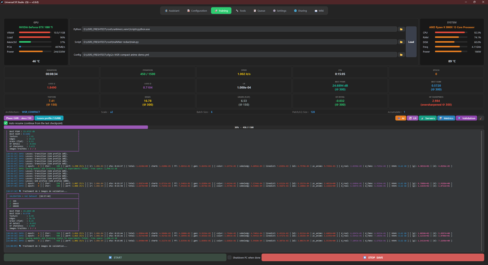 **Training** — live dashboard: GAN phase badge, loss transition, texture / edge / HF metrics, validation, Soft Stop | 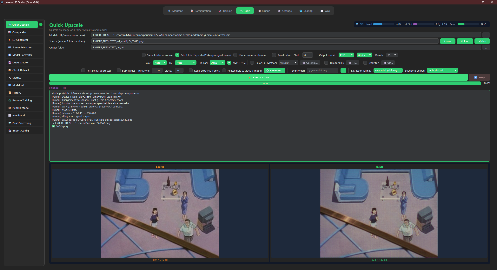 **Quick Upscale** — any trained model (here a custom WSR checkpoint), image / folder / video, side-by-side result |
| 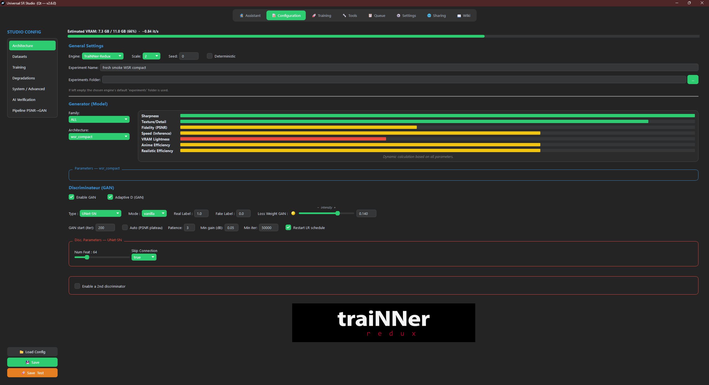 **Configuration** — architecture, capability bars, VRAM / speed estimate, discriminator, delayed GAN start | 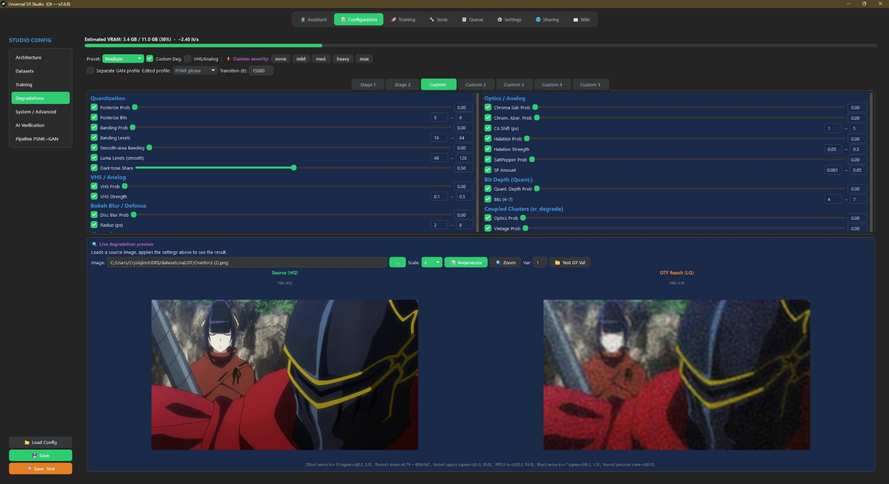 **Degradations** — custom degradations (banding, VHS, optics…) with live HQ → LQ preview |
| 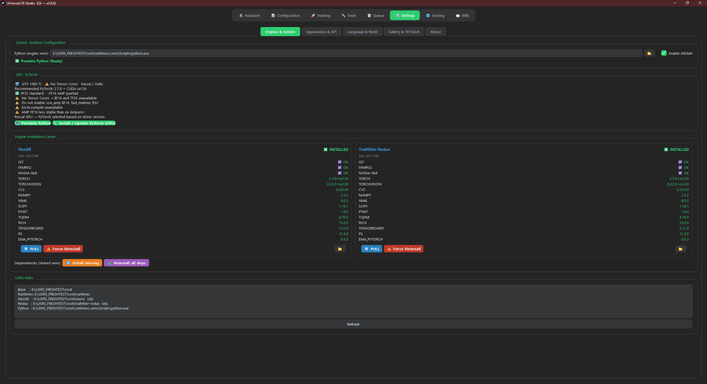 **Settings** — one-click engine installer (both engines on a fresh install) | 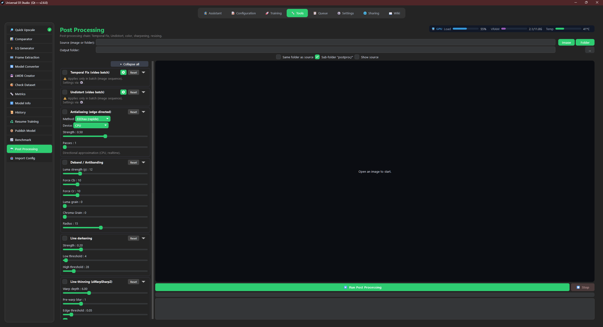 **Post Processing** — Temporal Fix, Undistort, anti-aliasing, deband, line tools |
| 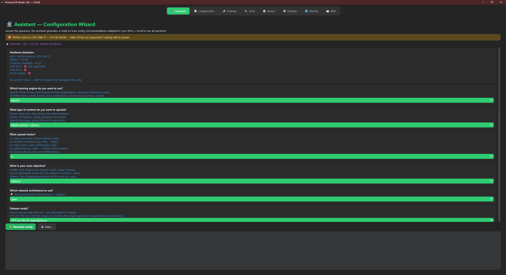 **Assistant** — guided config wizard with GPU detection | 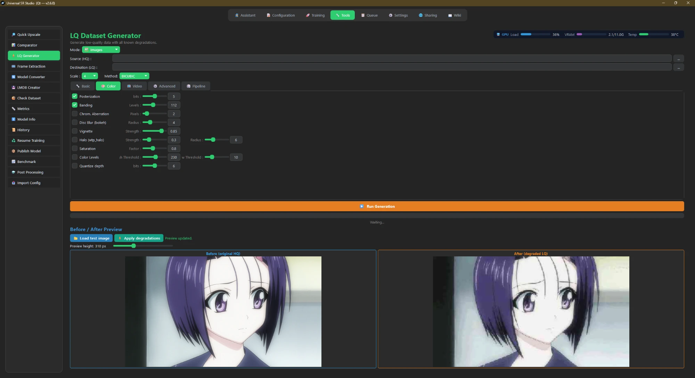 **LQ Generator** — build LQ datasets from HQ images or video, before / after preview |
| 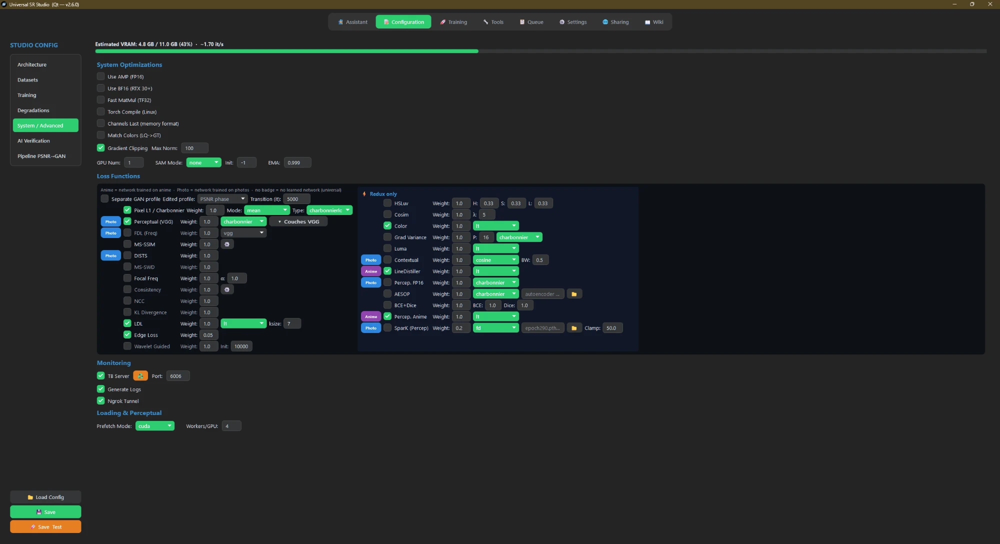 **Losses & system** — every loss with its criterion, anime / photo badges, Redux-only losses | 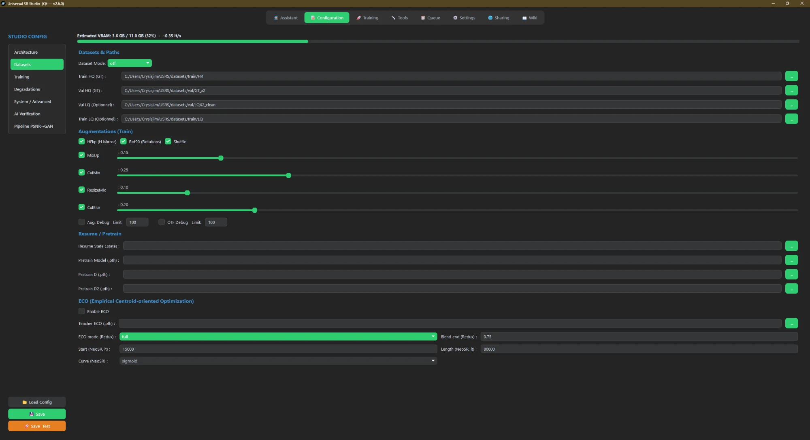 **Datasets** — OTF / paired modes, batch augmentations (MixUp, CutMix, CutBlur…), resume / pretrain |
| 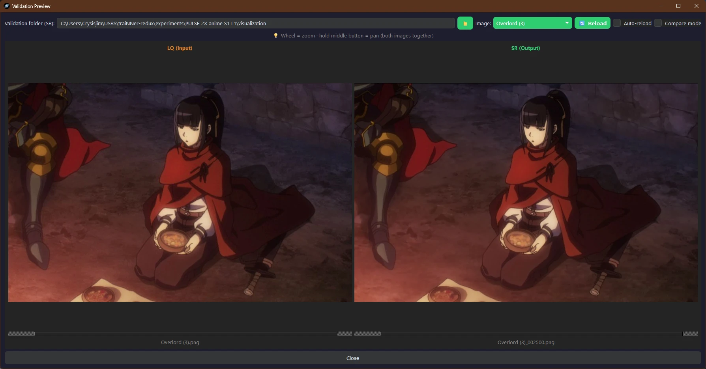 **Validation viewer** — LQ vs SR side by side, synced zoom & pan | |

### What's new in v2.5.7

- **New "⚗ Post Processing" tab** — post-process an image or a folder *after* upscaling, independently of the upscale step. Ordered chain: **Temporal Fix → Undistort → Color correction → Resize → Sharpen (UnsharpMask)**. Each stage has an enable toggle and a ⚙ settings popup, with a Before/After preview, a live log and a progress bar.
- **Temporal Fix** — reduces temporal flicker between frames. Modes: *Classic* (motion-aware blend, no weights) or neural models *S1 / S2 / S3* (pifroggi) with on-demand weight download. Backends: PyTorch CUDA, OnnxRuntime (CUDA), TensorRT + OnnxRuntime, CPU.
- **Undistort** — removes temporal high-frequency artifacts (shimmering / jittering edges on SR output). Modes: *Classic* (temporal HF median, no weights) or neural *TMT* (xg416), with the same backend choices and on-demand weights.
- **LQ Dataset Generator — full redesign** — the degradation tool is now organized into 5 tabs (**🔧 Basic · 🎨 Colour · 📺 Video · ⚙ Advanced · 🎲 Pipeline**) with ~30 degradations, each with a checkbox + live slider: blur, noise, JPEG/H.264 codec, posterization, banding, chromatic aberration, disc blur, vignette, halo, saturation, quantize depth, chroma subsampling, aliasing, interlace (weave / flicker / field blend), CRT scanlines, VHS/analog, screentone, dithering, sinusoidal distortion, pixel shift, film grain, oversharpening, motion blur, salt & pepper, halation, auto-crop patches. The new **🎲 Pipeline** tab adds a **probabilistic pipeline** (wtp_dataset_destroyer-style): **N passes (1–5)** and a **per-degradation probability** so the same config yields varied results across a dataset.
- **AI Training Analysis button (🤖)** — in the **Training** tab console header: sends the training log + config to a chosen AI provider to analyze your run and suggest adjustments.
- **SparkLoss `Clamp (max_score)` field** — now exposed in the Configuration losses block; the losses block was widened and aerated (full labels, no abbreviations) for the GAN training workflow.
- **Important fixes:**
  - **Mixed-resolution batches** — a folder mixing e.g. 1080p and 480p frames no longer crashes (`cannot reshape array of size …`) and no longer triggers a VRAM explosion + permanent slowdown (cuDNN autotune storm now disabled for inference; allocator defragmented on resolution change).
  - **Pascal GPUs (GTX 1080 / 1080 Ti, sm_61)** — Temporal Fix / Undistort now run inside the engine venv subprocess → fixes `no kernel image for device`.
  - **ONNX Temporal Fix** — fixed rank error (5D vs 4D input) on the OnnxRuntime backend.
  - **ORT performance** — the inference session is now cached once (no reload between frames).
  - GPU stats reliability (pynvml), zombie process on close, double-launch guard.

### What's new in v2.5.6

- **Shared venv** — single `runtimes/.venv` replaces dual neosr+traiNNer venvs; Python 3.12.9, numpy ≥2, traiNNer-redux `dev` branch; saves ~3 GB disk
- **New architectures** — custom-bundled and auto-injected: **ParagonSR** (nano/tiny/xs/s/m/l/xl/anime), **ParagonSR2** (photo/pro/realtime/stream/ultimate/ultimate_v2), **AetherNet** (NeoSR, mobile→extreme), FIGSR, GFISRv2, SMoSR, SPANpp; native in traiNNer-redux dev: srformer/v2, fdat, tfdat, spanf, spanplus, moesr/mosr/mosrv2, temporal_span_v2
- **GAN training training** — `RealESRGANModel` + `UNetDiscriminatorSN` pipeline; Adaptive D checkbox (auto-pauses discriminator to prevent collapse); SparkLoss FD + PerceptualAnimeLoss in Redux config; GAN weight persistence fix
- **Custom degradations** — Custom 3+4 groups now correctly applied to training (were wired in UI but missing from sidecar writer); 3 new effects (disc_blur, vignette, quantize_depth); 2 new coupled clusters; severity preset button; 68 total keys (was 29)
- **RCAN 1× fix** — bypass spandrel bug (wrong n_feats for 1× models); construction from state_dict directly
- **Crash fixes** — Thumbs.db auto-clean before validation; TensorBoard path in frozen exe; UnicodeEncodeError on Windows stdout; zombie process on close; double-launch guard
- **VRAM estimation** — calibrated for all ParagonSR, ParagonSR2 and AetherNet variants against real `torch.cuda.memory_reserved()` measurements

### Features

> Training super-resolution models usually means editing YAML files and babysitting a terminal.
> Universal SR Studio changes that — everything is visual, everything is in one place.

| | |
|--|--|
| 🎯 **Visual config editor** | Edit TOML/YAML with live VRAM estimation — know if your setup fits *before* starting |
| 📊 **Live training monitor** | Real-time loss curves, PSNR/SSIM, TensorBoard, GPU stats |
| 🤖 **AI training analysis** | Send your training log to Claude/GPT-4o/Gemini/Nemotron and get tuning advice in seconds |
| ⚡ **90+ architectures** | ParagonSR, ParagonSR2, AetherNet, FIGSR, SPAN, SRFormer, FDAT, MoESR, DocRes, and more — all one click away |
| 🎛 **GAN training** | Spectral / NeXtSRGAN / Projected discriminators, dual-discriminator mode, Adaptive D anti-collapse, SparkLoss FD, PerceptualAnimeLoss |
| ⚗ **Post Processing chain** | 9 stages: neural Temporal Fix, Undistort, Color, Resize, CAS Sharpen, Deband, Line Darken, Line Thinning, Edge Cleanup |
| 🎨 **LQ Dataset Generator** | ~30 degradations, probabilistic multi-pass pipeline — varied training data from a single config |
| 🚀 **Quick Upscale** | Batch thousands of frames with video-ready output numbering, duplicate skip, Color Fix ATWT |
| 📋 **Training queue** | Chain multiple training jobs back-to-back, unattended |
| 🌐 **Multi-provider AI** | OpenRouter, Nemotron, Claude, GPT-4o, Gemini — pick your provider |
| 🗂 **Dataset tools** | Frame extraction, dataset checker (HR/LQ pairs), LMDB converter, auto-crop patches |
| 🎨 **20+ themes** | Dark, light, custom — matches your workflow |
| 🌍 **Bilingual** | Full French / English interface |

**Perfect for:**
- 🖼 Anime / manga upscaling — line-art-aware post-processing, screentone and dithering degradations
- 📷 Photo and video restoration — VHS, film grain, lens artifacts, interlace simulation
- 🎬 Video super-resolution — frame-exact batch output, temporal consistency, TSPAN architecture support

<!-- ARCH_TABLE_EN_START -->
### Supported architectures

Every architecture below was **actually tested** (October 2026): its training config
was generated by the app and the network built by each engine that provides it, at 2x and
4x; the model was then run through Quick Upscale on a single image and on a folder with
the persistent subprocess (model loaded once for the whole batch), with the output size
checked.

- ✅ works · — not provided by that engine / not applicable · ⚠️ see note
- **Real trainings** (GTX 1080 Ti, 11 GB, 20 iterations, LQ 64): 134 of the 138 traiNNer-redux archs
  trained for real at 2x (batch 2, or batch 1 for the heaviest), and 49/49 NeoSR archs; x1, x3, x8 and
  the video archs at 2x/4x were trained too. GRL-B is too slow on this 11 GB card to be practical.
  MambaIR / MambaIR v2 need their CUDA kernel, shipped with the app (~1.9 it/s at batch 2 with it).
- **Video archs** run through Quick Upscale's sequence pipeline (multi-frame input), not
  per image; MoTSR is 2x only.
- **Scale not stored in the weights**: ParagonSR v1 and MSDAN use the scale chosen in Quick
  Upscale; SpanPP (IGConv) decodes several scales and defaults to 2x. DocRes is 1x.
- **ESCRealM**: its Flex attention needs `triton`, absent from a standard Windows install and
  unsupported on GPUs older than RTX 20; the app then switches it to the equivalent SDPA
  attention (training and Quick Upscale).
- **Added after the October sweep** (November 2026, trained and upscaled on real runs): **WSR** and **DUAL** (Rift73), **SPANF3** (AnimeJaNai V3 models load in Quick Upscale).

| Architecture | Variants | Category | Train · traiNNer-redux | Train · NeoSR | Quick Upscale | Persistent batch |
|---|---|---|:-:|:-:|:-:|:-:|
| aether | `aether_extreme`, `aether_large`, `aether_medium`, `aether_mobile`, `aether_pro`, `aether_small`, `aether_tiny` | **🆕 New / Community** | — | ✅ | ✅ | ✅ |
| artcnn | `artcnn_r16f96`, `artcnn_r3f24`, `artcnn_r8f48`, `artcnn_r8f64` | **🚀 Light / Fast** | ✅ | — | ✅ | ✅ |
| asid |  | **📦 Other** | — | ✅ | ✅ | ✅ |
| atd | `atd`, `atd_light` | **🤖 Transformers / Attention** | ✅ | ✅ | ✅ | ✅ |
| cascadedgaze |  | **🧪 Experimental / Heavy** | ✅ | — | ✅ | ✅ |
| catanet |  | **🆕 New / Community** | — | ✅ | ✅ | ✅ |
| cfsr |  | **📦 Other** | — | ✅ | ✅ | ✅ |
| compact |  | **🚀 Light / Fast** | ✅ | ✅ | ✅ | ✅ |
| craft |  | **🧪 Experimental / Heavy** | ✅ | ✅ | ✅ | ✅ |
| cugan |  | **🚀 Light / Fast** | — | ✅ | ✅ | ✅ |
| dat | `dat`, `dat_2`, `dat_light`, `dat_s` | **🤖 Transformers / Attention** | ✅ | ✅ | ✅ | ✅ |
| dat_iln | `dat_iln`, `dat_iln_2`, `dat_iln_light`, `dat_iln_s` | **🤖 Transformers / Attention** | ✅ | — | ✅ | ✅ |
| dct |  | **📦 Other** | — | ✅ | ✅ | ✅ |
| dctlsa |  | **🧪 Experimental / Heavy** | ✅ | ✅ | ✅ | ✅ |
| ditn | `ditn`, `ditn_real` | **🧪 Experimental / Heavy** | ✅ | ✅ | ✅ | ✅ |
| docres | `docres_base`, `docres_large` | **🗎 Document Restoration** | ✅ | — | ✅ | ✅ |
| drct | `drct`, `drct_l`, `drct_xl` | **🤖 Transformers / Attention** | ✅ | ✅ | ✅ | ✅ |
| dual | `dual_light`, `dual_xs`, `dual_s`, `dual_m`, `dual_l`, `dual_xl` | **🤖 Transformers / Attention** | ✅ | — | ✅ | ✅ |
| dwt | `dwt`, `dwt_s` | **🧪 Experimental / Heavy** | ✅ | — | ✅ | ✅ |
| eimn | `eimn`, `eimn_a`, `eimn_l` | **🧪 Experimental / Heavy** | ✅ | ✅ | ✅ | ✅ |
| elan | `elan`, `elan_light` | **🤖 Transformers / Attention** | ✅ | — | ✅ | ✅ |
| emt |  | **🧪 Experimental / Heavy** | ✅ | — | ✅ | ✅ |
| esc |  | **📦 Other** | — | ✅ | ✅ | ✅ |
| escrealm | `escrealm`, `escrealm_xl` | **🧪 Experimental / Heavy** | ✅ | — | ✅ | ✅ |
| esrgan | `esrgan`, `esrgan_lite` | **🚀 Light / Fast** | ✅ | ✅ | ✅ | ✅ |
| fdat | `fdat`, `fdat_light`, `fdat_xl` | **🧪 Experimental / Heavy** | ✅ | — | ✅ | ✅ |
| fdat_rd | `fdat_rd_large`, `fdat_rd_medium`, `fdat_rd_small` | **🆕 New / Community** | ✅ | — | ✅ | ✅ |
| figsr |  | **🆕 New / Community** | ✅ | — | ✅ | ✅ |
| flexnet |  | **🧪 Experimental / Heavy** | ✅ | ✅ | ✅ | ✅ |
| gaterv3 | `gaterv3`, `gaterv3_s` | **🧪 Experimental / Heavy** | ✅ | — | ✅ | ✅ |
| gfisrv2 |  | **🆕 New / Community** | ✅ | — | ✅ | ✅ |
| grformer |  | **📦 Other** | — | ✅ | ✅ | ✅ |
| grl | `grl_b`, `grl_s`, `grl_t` | **🧪 Experimental / Heavy** | ✅ | — | ✅ | ✅ |
| hasn |  | **📦 Other** | — | ✅ | ✅ | ✅ |
| hat | `hat_l`, `hat_m`, `hat_s` | **🤖 Transformers / Attention** | ✅ | ✅ | ✅ | ✅ |
| hat_iln | `hat_iln_l`, `hat_iln_l_aligned`, `hat_iln_m`, `hat_iln_m_aligned`, `hat_iln_s` | **🤖 Transformers / Attention** | ✅ | — | ✅ | ✅ |
| heart |  | **🆕 New / Community** | ✅ | — | ✅ | ✅ |
| hit_sir |  | **🧪 Experimental / Heavy** | ✅ | — | ✅ | ✅ |
| hit_sng |  | **🧪 Experimental / Heavy** | ✅ | — | ✅ | ✅ |
| hit_srf |  | **📦 Other** | — | ✅ | ✅ | ✅ |
| hma |  | **📦 Other** | — | ✅ | ✅ | ✅ |
| krgn |  | **📦 Other** | — | ✅ | ✅ | ✅ |
| lkfmixer | `lkfmixer_b`, `lkfmixer_l`, `lkfmixer_t` | **🧪 Experimental / Heavy** | ✅ | — | ✅ | ✅ |
| lmlt | `lmlt`, `lmlt_base`, `lmlt_large`, `lmlt_tiny` | **🧪 Experimental / Heavy** | ✅ | ✅ | ✅ | ✅ |
| mambair |  | **🆕 New / Community** | ✅ | — | ✅ | ✅ |
| mambairv2 |  | **🆕 New / Community** | ✅ | — | ✅ | ✅ |
| man | `man`, `man_light`, `man_tiny` | **🧪 Experimental / Heavy** | ✅ | ✅ | ✅ | ✅ |
| metaflexnet |  | **🧪 Experimental / Heavy** | ✅ | — | ✅ | ✅ |
| moesr |  | **📦 Other** | — | ✅ | ✅ | ✅ |
| moesr2 |  | **🧪 Experimental / Heavy** | ✅ | — | ✅ | ✅ |
| mosr | `mosr`, `mosr_t` | **🧪 Experimental / Heavy** | ✅ | — | ✅ | ✅ |
| mosrv2 |  | **🚀 Light / Fast** | ✅ | ✅ | ✅ | ✅ |
| motsr |  | **🎞️ Video / Temporal** | ✅ | — | ✅ video (sequence) | — (video) |
| msdan |  | **📦 Other** | — | ✅ | ✅ | ✅ |
| nerve |  | **🆕 New / Community** | ✅ | — | ✅ | ✅ |
| ninasr |  | **🚀 Light / Fast** | — | ✅ | ✅ | ✅ |
| omnisr |  | **🤖 Transformers / Attention** | ✅ | ✅ | ✅ | ✅ |
| paragonsr | `paragonsr_anime`, `paragonsr_l`, `paragonsr_m`, `paragonsr_nano`, `paragonsr_s`, `paragonsr_tiny`, `paragonsr_xl`, `paragonsr_xs` | **🏆 ParagonSR (Phhofm)** | ✅ | — | ✅ | ✅ |
| paragonsr2 | `paragonsr2_photo`, `paragonsr2_pro`, `paragonsr2_realtime`, `paragonsr2_stream`, `paragonsr2_ultimate`, `paragonsr2_ultimate_v2` | **🏆 ParagonSR (Phhofm)** | ✅ | — | ✅ | ✅ |
| plainusr |  | **📦 Other** | — | ✅ | ✅ | ✅ |
| plksr | `plksr`, `plksr_tiny` | **🚀 Light / Fast** | ✅ | ✅ | ✅ | ✅ |
| rcan | `rcan`, `rcan_l`, `rcan_unshuffle` | **🎨 GAN / Restoration** | ✅ | ✅ | ✅ | ✅ |
| realcugan |  | **🚀 Light / Fast** | ✅ | — | ✅ | ✅ |
| realplksr | `realplksr`, `realplksr_tiny` | **🚀 Light / Fast** | ✅ | ✅ | ✅ | ✅ |
| rgt | `rgt`, `rgt_s` | **🧪 Experimental / Heavy** | ✅ | ✅ | ✅ | ✅ |
| rtmosr | `rtmosr`, `rtmosr_l`, `rtmosr_ul` | **🚀 Light / Fast** | ✅ | — | ✅ | ✅ |
| safmn | `safmn`, `safmn_l` | **🚀 Light / Fast** | ✅ | ✅ | ✅ | ✅ |
| scunet_aaf6aa |  | **🎨 GAN / Restoration** | ✅ | — | ✅ | ✅ |
| sebica | `sebica`, `sebica_mini` | **🚀 Light / Fast** | ✅ | — | ✅ | ✅ |
| seemore_t |  | **🚀 Light / Fast** | ✅ | — | ✅ | ✅ |
| smosr |  | **🆕 New / Community** | ✅ | — | ✅ | ✅ |
| span | `span`, `span_s`, `spanf`, `spanpp` | **🚀 Light / Fast** | ✅ | ✅ | ✅ | ✅ |
| spanf3 |  | **🚀 Light / Fast** | ✅ | — | ✅ | ✅ |
| spanplus | `spanplus`, `spanplus_s`, `spanplus_st`, `spanplus_sts` | **🚀 Light / Fast** | ✅ | ✅ | ✅ | ✅ |
| srformer | `srformer`, `srformer_light`, `srformer_medium` | **🤖 Transformers / Attention** | ✅ | ✅ | ✅ | ✅ |
| srformerv2 |  | **🤖 Transformers / Attention** | ✅ | — | ✅ | ✅ |
| superultracompact |  | **🚀 Light / Fast** | ✅ | — | ✅ | ✅ |
| swin2sr | `swin2sr_l`, `swin2sr_m`, `swin2sr_s` | **🤖 Transformers / Attention** | ✅ | — | ✅ | ✅ |
| swinir | `swinir_l`, `swinir_m`, `swinir_medium`, `swinir_s`, `swinir_small` | **🤖 Transformers / Attention** | ✅ | ✅ | ✅ | ✅ |
| temporalspan | `temporalspan`, `temporalspanv2` | **🎞️ Video / Temporal** | ✅ | — | ✅ video (sequence) | — (video) |
| tfdat |  | **🎞️ Video / Temporal** | ✅ | — | ✅ video (sequence) | — (video) |
| tfdatv2 |  | **🎞️ Video / Temporal** | ✅ | — | ✅ video (sequence) | — (video) |
| tscunet |  | **🎞️ Video / Temporal** | ✅ | — | ✅ video (sequence) | — (video) |
| ultracompact |  | **🚀 Light / Fast** | ✅ | — | ✅ | ✅ |
| wiresr |  | **🆕 New / Community** | ✅ | — | ✅ | ✅ |
| wsr | `wsr_mobile`, `wsr_superultracompact`, `wsr_ultracompact`, `wsr_compact`, `wsr` | **🚀 Light / Fast** | ✅ | — | ✅ | ✅ |
<!-- ARCH_TABLE_EN_END -->

### Quick Start — Portable (recommended)

1. Download `Universal_SR_Studio_v2.6.0_portable.zip` from [Releases](https://github.com/Crysisjim/Universal-SR-Studio/releases)
2. Extract anywhere
3. Run `Universal_SR_Studio_QT\Universal_SR_Studio_QT.exe`
4. On first launch, choose your language (FR/EN), then go to **⚙️ Settings** → the built-in installer handles everything else

> No Python installation required: the portable build ships its own Python and installs the engines, PyTorch CUDA and every dependency itself. Optional model files (Guided Color Fix, NNEDI3 weights, Temporal Fix / Undistort models) are downloaded automatically the first time you use them.

### Prerequisites

- **Windows 10/11**
- **NVIDIA GPU** with CUDA support (8 GB+ VRAM recommended)
- **Internet connection** for the first setup (engine download)
- No Git, ffmpeg or Python needed: the app brings or downloads everything
- **~11 GB free disk space** for a full install (both engines + PyTorch CUDA + dependencies)

That's it. Universal SR Studio handles the rest automatically via the **⚙️ Settings** tab.

### Automatic Setup (via Settings tab)

| Step | What it does |
|------|-------------|
| **GPU detection** | Detects your GPU and recommends the correct PyTorch + CUDA version |
| **Engine install** | Downloads and installs NeoSR and/or traiNNer-Redux from their official repositories |
| **Virtual environment** | Creates a single shared `runtimes/.venv` (Python 3.12.9 + PyTorch CUDA) for all engines |
| **PyTorch** | Installs the correct CUDA-compatible version automatically |
| **Dependencies** | Installs all engine-specific packages, pinned to the versions this release was tested with |

Just open the **⚙️ Settings** tab, choose which engine(s) to install, and click — the console window shows live progress.

### Expected folder structure

```
~/USRS/
├── traiNNer-redux/            (installed via Settings)
├── neosr/                     (installed via Settings)
├── runtimes/
│   ├── python-3.12.9/         (portable Python)
│   └── .venv/                 (shared Python 3.12.9 + PyTorch CUDA environment)
├── datasets/
│   ├── train/HR/ , train/LQ/  (your training images)
│   └── val/GT/ , val/LQ/
├── experiments/  Final model/  weights/
├── models/                    (auto-downloaded helper models, e.g. colorfix/)
└── Option Custom/             (custom degradation presets)
```

### Source installation (developers)

```bash
git clone https://github.com/Crysisjim/Universal-SR-Studio.git
cd Universal-SR-Studio
pip install -r requirements.txt
python main_qt.py
```

Then use the **⚙️ Settings** tab to install the training engines.

### Tabs overview

| Tab | Description |
|-----|-------------|
| 😊 Assistant | Guided setup wizard for beginners |
| 📝 Configuration | TOML/YAML config editor with live OTF preview |
| 🚀 Training | Start/stop training, live curves, TensorBoard |
| 🔧 Tools | Benchmark, quick upscale, model export, dataset tools, ⚗ Post Processing (Temporal Fix / Undistort / color / resize / sharpen / deband / line-art modules) |
| 📋 Queue | Schedule multiple training sessions |
| ⚙️ Settings | Engine installer, paths, language, appearance, API keys |
| 🌐 Distributed | Multi-machine training (experimental) |
| 📖 Wiki | Opens the GitHub wiki documentation in your browser |

### Benchmarks (CLI)

```bash
# Architecture benchmark (traiNNer-Redux)
python src/core/benchmark_runner.py --engine redux --type arch

# Feature benchmark (NeoSR)
python src/core/benchmark_runner.py --engine neosr --type feature

# List available tests
python src/core/benchmark_runner.py --list
```

### Roadmap — next

| Feature | Description |
|---------|-------------|
| **EEDI3 without VapourSynth** | NNEDI3 anti-aliasing is native since v2.6; EEDI3 still needs VapourSynth. |
| **Up-to-date stack (v2.6.1)** | Move the traiNNer-redux pin to current `master` (torch ≥ 2.15, Triton, CUDA graphs) and refresh the pinned Python packages, keeping GTX 10 → RTX 50 support. |

> ⏸ **VOSR / OSEDiff** (diffusion-based SR, CVPR 2026) — integration paused indefinitely. Interest is limited due to very high VRAM requirements, making them impractical for most consumer GPUs.

### Contributing

Pull requests welcome. For major changes, open an issue first.

1. Fork the repository
2. Create a feature branch (`git checkout -b feature/my-feature`)
3. Commit your changes
4. Open a pull request

### License

[MIT](LICENSE) — free to use, modify, and distribute.

Bundled third-party architectures and auto-downloaded models keep their own licenses (some are non-commercial): see [THIRD_PARTY_NOTICES.md](THIRD_PARTY_NOTICES.md).

---

<a name="français"></a>
## 🇫🇷 Français

Interface graphique pour l'entraînement et la gestion de modèles d'IA super-résolution avec les moteurs **NeoSR** et **traiNNer-Redux**.

[](https://github.com/Crysisjim/Universal-SR-Studio/wiki)

### Nouveautés v2.6.0

La plus grosse mise à jour à ce jour — tout le détail dans la **[patch note v2.6.0](CHANGELOG.md#v260--français)**.

- **Nouvelle interface** — l'app a été réécrite en Qt (PySide6) : toutes les fonctions de la v2.5.7 portées et auditées, interface anglaise complète (~1 200 textes), infobulles FR/EN sur tous les réglages (y compris les paramètres par architecture), échelle de l'interface, progression dans la barre des tâches.
- **~45 architectures ajoutées ou rendues utilisables partout** — nouvelles et entraînables : TFDAT v2 (fait tourner 2x_bndl_animefilm_v3 de Bendel), MoTSR, MambaIR/MambaIRv2, HEART, NERVE, DocRes, WireSR, FDAT-RD ; 40+ autres fonctionnent maintenant dans Quick Upscale (modes normal et persistant), AetherNet réparé.
- **GAN** — nouveaux discriminateurs Spectral, NeXtSRGAN et Projected GAN, et un mode **double discriminateur** (n'importe quelle paire, Adaptive-D indépendant, avertissement sur les paires redondantes), **démarrage différé du GAN** (à une itération fixe ou automatiquement sur plateau du PSNR, avec relance optionnelle du planning LR) ; VRAM du discriminateur enfin comptée.
- **Pipeline vidéo** — mode d'entraînement séquence, entrée fichier vidéo pour n'importe quel modèle, options d'encodage (x264/x265/NVENC), séquences en vrai 16 bits, mode vidéo du générateur LQ, export ONNX des modèles vidéo, modèles vidéo dans la version portable.
- **Entraînement fiable** — validé sur de vrais entraînements et ~2 500 configurations générées : Soft Stop qui sauvegarde, tuilage de validation, aperçu OTF fidèle, réglages de dégradation cachés exposés, dégradations custom GPU corrigées, patchs moteur auto-réparants, estimations VRAM / vitesse mesurées par loss et par discriminateur, dégradations par phase PSNR → GAN, reprise qui ignore les états corrompus par un disque plein, alerte sur un set de validation à la mauvaise échelle.
- **Chaque fonction auditée et testée** — trois audits complets (147 constats : Quick Upscale, outils, réglages, post-traitement, publication) corrigés un par un et vérifiés sur données et entraînements réels : entraînement x3 OTF corrigé sur les deux moteurs, ordre des frames Temporal Fix / Undistort, 16 bits et qualité partout, import de config, LMDB, publication, reprise, benchmark ; estimations VRAM et vitesse recalibrées sur entraînements réels (162 et 159 archs).
- **Outils** — Extraction de frames, Color Fix guidé (aniCC), Convertisseur dans la version portable (ONNX taille fixe et vidéo), anti-crénelage NNEDI3 natif, dégradations DPID et DCT, import de configs.
- **Portable et moteurs** — zip autonome avec téléchargements au premier usage ; traiNNer-redux épinglé sur un commit `master` testé ; NeoSR toujours supporté.

### Captures d'écran

| | |
|---|---|
|  **Entraînement** — tableau de bord en direct : badge de phase GAN, transition des losses, métriques texture / contours / HF, validation, Soft Stop |  **Quick Upscale** — n'importe quel modèle entraîné (ici un checkpoint WSR custom), image / dossier / vidéo, résultat côte à côte |
|  **Configuration** — architecture, barres de capacités, estimation VRAM / vitesse, discriminateur, démarrage GAN différé |  **Dégradations** — dégradations custom (banding, VHS, optique…) avec aperçu HQ → LQ en direct |
|  **Paramètres** — installation des moteurs en un clic (les deux moteurs sur une installation neuve) |  **Post Processing** — Temporal Fix, Undistort, anti-crénelage, deband, outils de lignes |
|  **Assistant** — assistant de configuration guidé avec détection du GPU |  **Générateur LQ** — crée des datasets LQ depuis des images HQ ou une vidéo, aperçu avant / après |
|  **Losses & système** — toutes les losses avec leur critère, badges anime / photo, losses réservées à Redux |  **Datasets** — modes OTF / appairé, augmentations (MixUp, CutMix, CutBlur…), reprise / pretrain |
|  **Visionneuse de validation** — LQ et SR côte à côte, zoom et déplacement synchronisés | |

### Nouveautés v2.5.7

- **Nouvel onglet "⚗ Post Processing"** — post-traiter une image ou un dossier *après* l'upscale, indépendamment. Chaîne ordonnée : **Temporal Fix → Undistort → Correction couleur → Redimensionnement → Netteté (UnsharpMask)**. Chaque étape a une case enable + un popup ⚙ de réglages, avec preview Avant/Après, log live et barre de progression.
- **Temporal Fix** — réduit le scintillement temporel entre frames. Modes : *Classic* (blend motion-aware, sans poids) ou modèles neuraux *S1 / S2 / S3* (pifroggi) avec téléchargement des poids à la demande. Backends : PyTorch CUDA, OnnxRuntime (CUDA), TensorRT + OnnxRuntime, CPU.
- **Undistort** — supprime les artefacts haute-fréquence temporels (bords qui scintillent/tremblent sur la sortie SR). Modes : *Classic* (médiane HF temporelle, sans poids) ou neural *TMT* (xg416), mêmes choix de backend + poids à la demande.
- **Générateur de dataset LQ — refonte complète** — l'outil de dégradation est maintenant organisé en 5 onglets (**🔧 Basique · 🎨 Couleur · 📺 Vidéo · ⚙ Avancé · 🎲 Pipeline**) avec ~30 dégradations, chacune avec case + slider live : flou, bruit, codec JPEG/H.264, postérisation, banding, aberration chromatique, flou disque, vignette, halo, saturation, quantize depth, sous-échantillonnage chroma, aliasing, entrelacement (weave / flicker / field blend), scanlines CRT, VHS/analog, screentone, dithering, distorsion sinusoïdale, pixel shift, grain de film, oversharpening, motion blur, sel & poivre, halation, auto-crop patches. Le nouvel onglet **🎲 Pipeline** ajoute un **pipeline probabiliste** (style wtp_dataset_destroyer) : **N passes (1–5)** et une **probabilité par dégradation** → une même config produit des résultats variés sur tout un dataset.
- **Bouton Analyse IA (🤖)** — dans l'en-tête de la console de l'onglet **Entraînement** : envoie le log + la config à un provider IA pour analyser l'entraînement et suggérer des ajustements.
- **Champ `Clamp (max_score)` SparkLoss** — maintenant exposé dans le bloc losses de Configuration ; bloc losses élargi et aéré (labels complets, plus d'abréviations) pour le workflow GAN training.
- **Corrections importantes :**
  - **Batchs multi-résolution** — un dossier mélangeant par ex. du 1080p et du 480p ne plante plus (`cannot reshape array of size …`) et ne déclenche plus d'explosion VRAM + ralentissement permanent (tempête d'autotune cuDNN désactivée en inférence ; allocateur défragmenté au changement de résolution).
  - **GPU Pascal (GTX 1080 / 1080 Ti, sm_61)** — Temporal Fix / Undistort tournent désormais dans le subprocess venv du moteur → corrige `no kernel image for device`.
  - **ONNX Temporal Fix** — erreur de rang corrigée (entrée 5D vs 4D) sur le backend OnnxRuntime.
  - **Performance ORT** — la session d'inférence est mise en cache une seule fois (plus de rechargement entre frames).
  - Fiabilité stats GPU (pynvml), processus zombie à la fermeture, garde anti-double-lancement.

### Nouveautés v2.5.6

- **Venv partagé** — un seul `runtimes/.venv` remplace les deux venvs neosr+traiNNer ; Python 3.12.9, numpy ≥2, branche `dev` traiNNer-redux ; économise ~3 Go
- **Nouvelles architectures** — custom bundlées et auto-injectées : **ParagonSR** (nano/tiny/xs/s/m/l/xl/anime), **ParagonSR2** (photo/pro/realtime/stream/ultimate/ultimate_v2), **AetherNet** (NeoSR, mobile→extreme), FIGSR, GFISRv2, SMoSR, SPANpp ; natives dans traiNNer-redux dev : srformer/v2, fdat, tfdat, spanf, spanplus, moesr/mosr/mosrv2, temporal_span_v2
- **Entraînement GAN** — pipeline `RealESRGANModel` + `UNetDiscriminatorSN` ; checkbox Adaptive D (met le discriminateur en pause pour éviter l'effondrement) ; SparkLoss FD + PerceptualAnimeLoss dans la config Redux ; fix persistance du poids GAN
- **Dégradations custom** — groupes Custom 3+4 maintenant correctement appliqués à l'entraînement (câblés dans l'UI mais absents du sidecar) ; 3 nouveaux effets (disc_blur, vignette, quantize_depth) ; 2 clusters couplés ; bouton preset de sévérité ; 68 clés au total (était 29)
- **Fix RCAN 1×** — contournement du bug spandrel (n_feats incorrect pour les modèles 1×) ; construction directe depuis le state_dict
- **Fixes crashs** — nettoyage automatique Thumbs.db avant validation ; chemin TensorBoard dans l'exe portable ; UnicodeEncodeError sur stdout Windows ; processus zombie à la fermeture ; garde anti-double-lancement
- **Estimation VRAM** — calibrée pour tous les variants ParagonSR, ParagonSR2 et AetherNet sur des mesures `torch.cuda.memory_reserved()` réelles

### Fonctionnalités

> Entraîner des modèles de super-résolution demande habituellement d'éditer des YAML à la main et de surveiller un terminal.
> Universal SR Studio change ça — tout est visuel, tout est au même endroit.

| | |
|--|--|
| 🎯 **Éditeur de config visuel** | TOML/YAML avec estimation VRAM live — savoir si le setup tient *avant* de lancer |
| 📊 **Monitoring en temps réel** | Courbes de pertes, PSNR/SSIM, TensorBoard, stats GPU |
| 🤖 **Analyse IA d'entraînement** | Envoyer le log à Claude/GPT-4o/Gemini/Nemotron et recevoir des suggestions de réglages en secondes |
| ⚡ **90+ architectures** | ParagonSR, ParagonSR2, AetherNet, FIGSR, SPAN, SRFormer, FDAT, MoESR, DocRes, et plus — un clic suffit |
| 🎛 **Entraînement GAN** | Discriminateurs Spectral / NeXtSRGAN / Projected, mode double discriminateur, Adaptive D anti-collapse, SparkLoss FD, PerceptualAnimeLoss |
| ⚗ **Chaîne Post Processing** | 9 étapes : Temporal Fix neural, Undistort, Couleur, Resize, Netteté CAS, Deband, Renforcement lignes, Amincissement lignes, Edge Cleanup |
| 🎨 **Générateur LQ** | ~30 dégradations, pipeline multi-passes probabiliste — données d'entraînement variées depuis une seule config |
| 🚀 **Quick Upscale** | Batch de milliers de frames avec numérotation vidéo prête, skip doublons, Color Fix ATWT |
| 📋 **File d'entraînements** | Enchaîner plusieurs jobs sans surveillance |
| 🌐 **IA multi-providers** | OpenRouter, Nemotron, Claude, GPT-4o, Gemini — choisir le provider |
| 🗂 **Outils dataset** | Extraction de frames, vérification de dataset (paires HR/LQ), convertisseur LMDB, découpe en patchs |
| 🎨 **20+ thèmes** | Sombre, clair, personnalisé — selon vos préférences |
| 🌍 **Bilingue** | Interface entièrement en Français / Anglais |

**Idéal pour :**
- 🖼 Upscale anime / manga — post-processing adapté aux lignes, screentone et dithering
- 📷 Restauration photo et vidéo — VHS, grain film, artefacts optiques, entrelacement
- 🎬 Super-résolution vidéo — sortie frame-exact, cohérence temporelle, support architecture TSPAN

<!-- ARCH_TABLE_FR_START -->
### Architectures supportées

Chaque architecture ci-dessous a été **réellement testée** (octobre 2026) : config
d'entraînement générée par l'app et réseau construit par chaque moteur qui la fournit, en
2x et 4x ; le modèle est ensuite passé dans Quick Upscale sur une image seule et sur un
dossier avec le subprocess persistant (modèle chargé une seule fois pour tout le lot), avec
contrôle de la taille de sortie.

- ✅ fonctionne · — absent de ce moteur / sans objet · ⚠️ voir la note
- **Entraînements réels** (GTX 1080 Ti, 11 Go, 20 itérations, LQ 64) : 134 des 138 archs traiNNer-redux
  entraînées pour de vrai en 2x (batch 2, ou batch 1 pour les plus lourdes), et 49/49 archs
  NeoSR ; x1, x3, x8 et les archs vidéo en 2x/4x ont été entraînés aussi. Sur cette
  carte de 11 Go, GRL-B est trop lent pour un usage pratique. MambaIR / MambaIR v2 ont besoin de
  leur kernel CUDA, livré avec l'app (~1,9 it/s en batch 2 avec lui).
- **Archs vidéo** : elles passent par le pipeline séquence de Quick Upscale (plusieurs
  images en entrée), pas image par image ; MoTSR est 2x uniquement.
- **Échelle absente des poids** : ParagonSR v1 et MSDAN utilisent l'échelle choisie dans
  Quick Upscale ; SpanPP (IGConv) sait décoder plusieurs échelles, 2x par défaut. DocRes
  est en 1x.
- **ESCRealM** : son attention Flex demande `triton`, absent d'une installation Windows
  standard et non supporté avant les RTX 20 ; l'app bascule alors sur l'attention SDPA
  équivalente (entraînement et Quick Upscale).
- **Ajoutées après la campagne d'octobre** (novembre 2026, entraînées et testées en Quick Upscale) : **WSR** et **DUAL** (Rift73), **SPANF3** (les modèles AnimeJaNai V3 se chargent dans Quick Upscale).

| Architecture | Variantes | Catégorie | Entraînement · traiNNer-redux | Entraînement · NeoSR | Quick Upscale | Batch persistant |
|---|---|---|:-:|:-:|:-:|:-:|
| aether | `aether_extreme`, `aether_large`, `aether_medium`, `aether_mobile`, `aether_pro`, `aether_small`, `aether_tiny` | **🆕 Nouveaux / Communauté** | — | ✅ | ✅ | ✅ |
| artcnn | `artcnn_r16f96`, `artcnn_r3f24`, `artcnn_r8f48`, `artcnn_r8f64` | **🚀 Léger / Rapide** | ✅ | — | ✅ | ✅ |
| asid |  | **📦 Autres** | — | ✅ | ✅ | ✅ |
| atd | `atd`, `atd_light` | **🤖 Transformers / Attention** | ✅ | ✅ | ✅ | ✅ |
| cascadedgaze |  | **🧪 Expérimental / Lourd** | ✅ | — | ✅ | ✅ |
| catanet |  | **🆕 Nouveaux / Communauté** | — | ✅ | ✅ | ✅ |
| cfsr |  | **📦 Autres** | — | ✅ | ✅ | ✅ |
| compact |  | **🚀 Léger / Rapide** | ✅ | ✅ | ✅ | ✅ |
| craft |  | **🧪 Expérimental / Lourd** | ✅ | ✅ | ✅ | ✅ |
| cugan |  | **🚀 Léger / Rapide** | — | ✅ | ✅ | ✅ |
| dat | `dat`, `dat_2`, `dat_light`, `dat_s` | **🤖 Transformers / Attention** | ✅ | ✅ | ✅ | ✅ |
| dat_iln | `dat_iln`, `dat_iln_2`, `dat_iln_light`, `dat_iln_s` | **🤖 Transformers / Attention** | ✅ | — | ✅ | ✅ |
| dct |  | **📦 Autres** | — | ✅ | ✅ | ✅ |
| dctlsa |  | **🧪 Expérimental / Lourd** | ✅ | ✅ | ✅ | ✅ |
| ditn | `ditn`, `ditn_real` | **🧪 Expérimental / Lourd** | ✅ | ✅ | ✅ | ✅ |
| docres | `docres_base`, `docres_large` | **🗎 Restauration Document** | ✅ | — | ✅ | ✅ |
| drct | `drct`, `drct_l`, `drct_xl` | **🤖 Transformers / Attention** | ✅ | ✅ | ✅ | ✅ |
| dual | `dual_light`, `dual_xs`, `dual_s`, `dual_m`, `dual_l`, `dual_xl` | **🤖 Transformers / Attention** | ✅ | — | ✅ | ✅ |
| dwt | `dwt`, `dwt_s` | **🧪 Expérimental / Lourd** | ✅ | — | ✅ | ✅ |
| eimn | `eimn`, `eimn_a`, `eimn_l` | **🧪 Expérimental / Lourd** | ✅ | ✅ | ✅ | ✅ |
| elan | `elan`, `elan_light` | **🤖 Transformers / Attention** | ✅ | — | ✅ | ✅ |
| emt |  | **🧪 Expérimental / Lourd** | ✅ | — | ✅ | ✅ |
| esc |  | **📦 Autres** | — | ✅ | ✅ | ✅ |
| escrealm | `escrealm`, `escrealm_xl` | **🧪 Expérimental / Lourd** | ✅ | — | ✅ | ✅ |
| esrgan | `esrgan`, `esrgan_lite` | **🚀 Léger / Rapide** | ✅ | ✅ | ✅ | ✅ |
| fdat | `fdat`, `fdat_light`, `fdat_xl` | **🧪 Expérimental / Lourd** | ✅ | — | ✅ | ✅ |
| fdat_rd | `fdat_rd_large`, `fdat_rd_medium`, `fdat_rd_small` | **🆕 Nouveaux / Communauté** | ✅ | — | ✅ | ✅ |
| figsr |  | **🆕 Nouveaux / Communauté** | ✅ | — | ✅ | ✅ |
| flexnet |  | **🧪 Expérimental / Lourd** | ✅ | ✅ | ✅ | ✅ |
| gaterv3 | `gaterv3`, `gaterv3_s` | **🧪 Expérimental / Lourd** | ✅ | — | ✅ | ✅ |
| gfisrv2 |  | **🆕 Nouveaux / Communauté** | ✅ | — | ✅ | ✅ |
| grformer |  | **📦 Autres** | — | ✅ | ✅ | ✅ |
| grl | `grl_b`, `grl_s`, `grl_t` | **🧪 Expérimental / Lourd** | ✅ | — | ✅ | ✅ |
| hasn |  | **📦 Autres** | — | ✅ | ✅ | ✅ |
| hat | `hat_l`, `hat_m`, `hat_s` | **🤖 Transformers / Attention** | ✅ | ✅ | ✅ | ✅ |
| hat_iln | `hat_iln_l`, `hat_iln_l_aligned`, `hat_iln_m`, `hat_iln_m_aligned`, `hat_iln_s` | **🤖 Transformers / Attention** | ✅ | — | ✅ | ✅ |
| heart |  | **🆕 Nouveaux / Communauté** | ✅ | — | ✅ | ✅ |
| hit_sir |  | **🧪 Expérimental / Lourd** | ✅ | — | ✅ | ✅ |
| hit_sng |  | **🧪 Expérimental / Lourd** | ✅ | — | ✅ | ✅ |
| hit_srf |  | **📦 Autres** | — | ✅ | ✅ | ✅ |
| hma |  | **📦 Autres** | — | ✅ | ✅ | ✅ |
| krgn |  | **📦 Autres** | — | ✅ | ✅ | ✅ |
| lkfmixer | `lkfmixer_b`, `lkfmixer_l`, `lkfmixer_t` | **🧪 Expérimental / Lourd** | ✅ | — | ✅ | ✅ |
| lmlt | `lmlt`, `lmlt_base`, `lmlt_large`, `lmlt_tiny` | **🧪 Expérimental / Lourd** | ✅ | ✅ | ✅ | ✅ |
| mambair |  | **🆕 Nouveaux / Communauté** | ✅ | — | ✅ | ✅ |
| mambairv2 |  | **🆕 Nouveaux / Communauté** | ✅ | — | ✅ | ✅ |
| man | `man`, `man_light`, `man_tiny` | **🧪 Expérimental / Lourd** | ✅ | ✅ | ✅ | ✅ |
| metaflexnet |  | **🧪 Expérimental / Lourd** | ✅ | — | ✅ | ✅ |
| moesr |  | **📦 Autres** | — | ✅ | ✅ | ✅ |
| moesr2 |  | **🧪 Expérimental / Lourd** | ✅ | — | ✅ | ✅ |
| mosr | `mosr`, `mosr_t` | **🧪 Expérimental / Lourd** | ✅ | — | ✅ | ✅ |
| mosrv2 |  | **🚀 Léger / Rapide** | ✅ | ✅ | ✅ | ✅ |
| motsr |  | **🎞️ Vidéo / Temporal** | ✅ | — | ✅ vidéo (séquence) | — (vidéo) |
| msdan |  | **📦 Autres** | — | ✅ | ✅ | ✅ |
| nerve |  | **🆕 Nouveaux / Communauté** | ✅ | — | ✅ | ✅ |
| ninasr |  | **🚀 Léger / Rapide** | — | ✅ | ✅ | ✅ |
| omnisr |  | **🤖 Transformers / Attention** | ✅ | ✅ | ✅ | ✅ |
| paragonsr | `paragonsr_anime`, `paragonsr_l`, `paragonsr_m`, `paragonsr_nano`, `paragonsr_s`, `paragonsr_tiny`, `paragonsr_xl`, `paragonsr_xs` | **🆕 Nouveaux / Communauté** | ✅ | — | ✅ | ✅ |
| paragonsr2 | `paragonsr2_photo`, `paragonsr2_pro`, `paragonsr2_realtime`, `paragonsr2_stream`, `paragonsr2_ultimate`, `paragonsr2_ultimate_v2` | **🆕 Nouveaux / Communauté** | ✅ | — | ✅ | ✅ |
| plainusr |  | **📦 Autres** | — | ✅ | ✅ | ✅ |
| plksr | `plksr`, `plksr_tiny` | **🚀 Léger / Rapide** | ✅ | ✅ | ✅ | ✅ |
| rcan | `rcan`, `rcan_l`, `rcan_unshuffle` | **🎨 GAN / Restauration** | ✅ | ✅ | ✅ | ✅ |
| realcugan |  | **🚀 Léger / Rapide** | ✅ | — | ✅ | ✅ |
| realplksr | `realplksr`, `realplksr_tiny` | **🚀 Léger / Rapide** | ✅ | ✅ | ✅ | ✅ |
| rgt | `rgt`, `rgt_s` | **🧪 Expérimental / Lourd** | ✅ | ✅ | ✅ | ✅ |
| rtmosr | `rtmosr`, `rtmosr_l`, `rtmosr_ul` | **🚀 Léger / Rapide** | ✅ | — | ✅ | ✅ |
| safmn | `safmn`, `safmn_l` | **🚀 Léger / Rapide** | ✅ | ✅ | ✅ | ✅ |
| scunet_aaf6aa |  | **🎨 GAN / Restauration** | ✅ | — | ✅ | ✅ |
| sebica | `sebica`, `sebica_mini` | **🚀 Léger / Rapide** | ✅ | — | ✅ | ✅ |
| seemore_t |  | **🚀 Léger / Rapide** | ✅ | — | ✅ | ✅ |
| smosr |  | **🆕 Nouveaux / Communauté** | ✅ | — | ✅ | ✅ |
| span | `span`, `span_s`, `spanf`, `spanpp` | **🚀 Léger / Rapide** | ✅ | ✅ | ✅ | ✅ |
| spanf3 |  | **🚀 Léger / Rapide** | ✅ | — | ✅ | ✅ |
| spanplus | `spanplus`, `spanplus_s`, `spanplus_st`, `spanplus_sts` | **🚀 Léger / Rapide** | ✅ | ✅ | ✅ | ✅ |
| srformer | `srformer`, `srformer_light`, `srformer_medium` | **🤖 Transformers / Attention** | ✅ | ✅ | ✅ | ✅ |
| srformerv2 |  | **🤖 Transformers / Attention** | ✅ | — | ✅ | ✅ |
| superultracompact |  | **🚀 Léger / Rapide** | ✅ | — | ✅ | ✅ |
| swin2sr | `swin2sr_l`, `swin2sr_m`, `swin2sr_s` | **🤖 Transformers / Attention** | ✅ | — | ✅ | ✅ |
| swinir | `swinir_l`, `swinir_m`, `swinir_medium`, `swinir_s`, `swinir_small` | **🤖 Transformers / Attention** | ✅ | ✅ | ✅ | ✅ |
| temporalspan | `temporalspan`, `temporalspanv2` | **🎞️ Vidéo / Temporal** | ✅ | — | ✅ vidéo (séquence) | — (vidéo) |
| tfdat |  | **🎞️ Vidéo / Temporal** | ✅ | — | ✅ vidéo (séquence) | — (vidéo) |
| tfdatv2 |  | **🎞️ Vidéo / Temporal** | ✅ | — | ✅ vidéo (séquence) | — (vidéo) |
| tscunet |  | **🎞️ Vidéo / Temporal** | ✅ | — | ✅ vidéo (séquence) | — (vidéo) |
| ultracompact |  | **🚀 Léger / Rapide** | ✅ | — | ✅ | ✅ |
| wiresr |  | **🆕 Nouveaux / Communauté** | ✅ | — | ✅ | ✅ |
| wsr | `wsr_mobile`, `wsr_superultracompact`, `wsr_ultracompact`, `wsr_compact`, `wsr` | **🚀 Léger / Rapide** | ✅ | — | ✅ | ✅ |
<!-- ARCH_TABLE_FR_END -->

### Démarrage rapide — Portable (recommandé)

1. Télécharger `Universal_SR_Studio_v2.6.0_portable.zip` depuis les [Releases](https://github.com/Crysisjim/Universal-SR-Studio/releases)
2. Extraire n'importe où
3. Lancer `Universal_SR_Studio_QT\Universal_SR_Studio_QT.exe`
4. Au premier lancement, choisir la langue (FR/EN), puis aller dans **⚙️ Paramètres** → l'installeur intégré gère le reste

> Aucune installation Python requise : la version portable embarque son propre Python et installe elle-même les moteurs, PyTorch CUDA et toutes les dépendances. Les fichiers de modèles optionnels (Color Fix guidé, poids NNEDI3, modèles Temporal Fix / Undistort) sont téléchargés automatiquement à leur première utilisation.

### Prérequis

- **Windows 10/11**
- **GPU NVIDIA** avec support CUDA (8 Go+ VRAM recommandé)
- **Connexion internet** pour le premier setup (téléchargement des moteurs)
- Ni Git, ni ffmpeg, ni Python à installer : l'app fournit ou télécharge tout
- **~11 Go d'espace disque libre** pour une installation complète (les deux moteurs + PyTorch CUDA + dépendances)

C'est tout. Universal SR Studio gère le reste automatiquement via l'onglet **⚙️ Paramètres**.

### Installation automatique (via l'onglet Paramètres)

| Étape | Action |
|-------|--------|
| **Détection GPU** | Détecte le GPU et recommande la bonne version PyTorch + CUDA |
| **Installation moteur** | Télécharge et installe NeoSR et/ou traiNNer-Redux depuis leurs dépôts officiels |
| **Environnement virtuel** | Crée un seul `runtimes/.venv` partagé (Python 3.12.9 + PyTorch CUDA) pour tous les moteurs |
| **PyTorch** | Installe la version compatible CUDA automatiquement |
| **Dépendances** | Installe tous les packages spécifiques au moteur, figés sur les versions testées pour cette version |

Ouvrir l'onglet **⚙️ Paramètres**, choisir le(s) moteur(s) à installer, et cliquer — la console affiche la progression en direct.

### Structure de dossiers attendue

```
~/USRS/
├── traiNNer-redux/            (installé via Paramètres)
├── neosr/                     (installé via Paramètres)
├── runtimes/
│   ├── python-3.12.9/         (Python portable)
│   └── .venv/                 (environnement Python 3.12.9 + PyTorch CUDA partagé)
├── datasets/
│   ├── train/HR/ , train/LQ/  (vos images d'entraînement)
│   └── val/GT/ , val/LQ/
├── experiments/  Final model/  weights/
├── models/                    (modèles annexes téléchargés automatiquement, ex. colorfix/)
└── Option Custom/             (presets de dégradation personnalisés)
```

### Installation source (développeurs)

```bash
git clone https://github.com/Crysisjim/Universal-SR-Studio.git
cd Universal-SR-Studio
pip install -r requirements.txt
python main_qt.py
```

Puis utiliser l'onglet **⚙️ Paramètres** pour installer les moteurs d'entraînement.

### Aperçu des onglets

| Onglet | Description |
|--------|-------------|
| 😊 Assistant | Wizard de configuration guidée pour débutants |
| 📝 Configuration | Éditeur TOML/YAML avec prévisualisation OTF live |
| 🚀 Entraînement | Démarrer/arrêter, courbes live, TensorBoard |
| 🔧 Outils | Benchmark, upscale rapide, export modèle, outils dataset, ⚗ Post Processing (Temporal Fix / Undistort / couleur / resize / netteté / deband / modules line-art) |
| 📋 File d'attente | Planifier plusieurs sessions d'entraînement |
| ⚙️ Paramètres | Installeur moteurs, chemins, langue, apparence, clés API |
| 🌐 Distribué | Entraînement multi-machines (expérimental) |
| 📖 Wiki | Ouvre la documentation wiki GitHub dans le navigateur |

### Roadmap — à venir

| Fonctionnalité | Description |
|---------|-------------|
| **EEDI3 sans VapourSynth** | L'anti-crénelage NNEDI3 est natif depuis la v2.6 ; EEDI3 demande encore VapourSynth. |
| **Pile à jour (v2.6.1)** | Avancer l'épinglage traiNNer-redux sur le `master` actuel (torch ≥ 2.15, Triton, CUDA graphs) et rafraîchir les paquets Python figés, en gardant le support GTX 10 → RTX 50. |

> ⏸ **VOSR / OSEDiff** (SR par diffusion, CVPR 2026) — intégration en pause indéfinie. Intérêt limité en raison d'une consommation VRAM très élevée, peu pratique sur la majorité des GPU grand public.

### Contribuer

Les pull requests sont les bienvenues. Pour les changements majeurs, ouvrir une issue d'abord.

1. Forker le dépôt
2. Créer une branche (`git checkout -b feature/ma-feature`)
3. Commiter les changements
4. Ouvrir une pull request

### Licence

[MIT](LICENSE) — libre d'utilisation, de modification et de distribution.

Les architectures tierces incluses et les modèles téléchargés automatiquement gardent leurs propres licences (certaines non commerciales) : voir [THIRD_PARTY_NOTICES.md](THIRD_PARTY_NOTICES.md).
